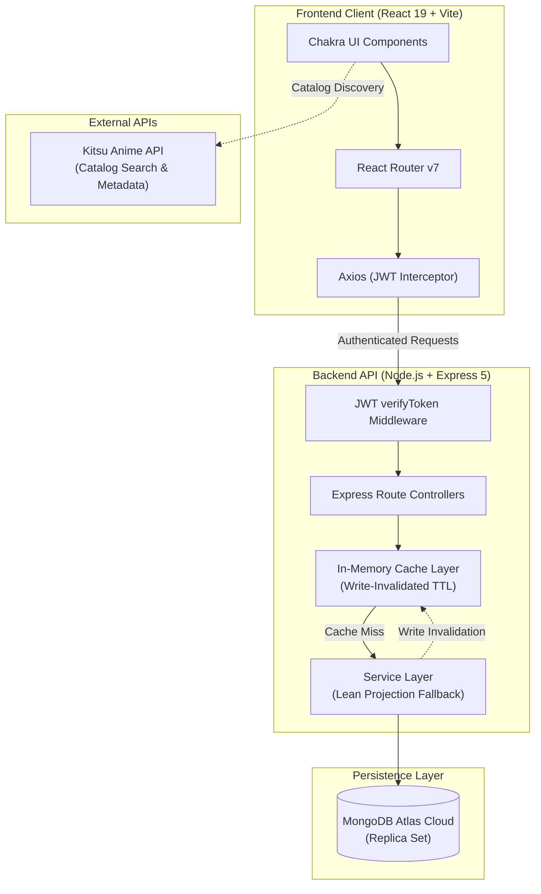

# Sugooianime — Production-Grade Anime Discovery & High-Throughput Platform

[](https://react.dev/)
[](https://nodejs.org/)
[](https://expressjs.com/)
[](https://www.mongodb.com/atlas)
[](https://k6.io/)
[](#performance-benchmarking--scalability-engineering)
[](#performance-benchmarking--scalability-engineering)
[](https://deepwiki.com/UJ474/Sugooianimes)

Sugooianime is a full-stack, high-concurrency anime discovery and watch-tracking platform inspired by MyAnimeList and IMDb. Built with a responsive React frontend, a Node.js/Express REST API, and MongoDB Atlas, the system features a dedicated performance engineering suite that achieves **>21,800 RPS** with sub-millisecond median latencies under concurrent load.

---

## Live Deployments

| Component | Production URL |
|---|---|
| **Web Client** | [https://sugooianimes.vercel.app/](https://sugooianimes.vercel.app/) |
| **API Server** | [https://sugooianimes-server.vercel.app/](https://sugooianimes-server.vercel.app/) |

---

## Performance Benchmarking & Scalability Engineering

A core objective of this project was engineering for production-scale traffic. Using **Grafana k6**, the platform underwent comprehensive load testing, bottleneck profiling, and optimization across isolated and concurrent workload stages.

### Performance Highlights

```
========================================================================================
                      ARCHITECTURAL OPTIMIZATION BENCHMARK
========================================================================================
Metric                              Baseline                Optimized           Delta
----------------------------------------------------------------------------------------
Watchlist Read Throughput        101.9 req/s         21,839.8 req/s      +21,332% (214x)
Watchlist Median Latency          34.90 ms                 0.36 ms       -98.97% faster
Watchlist P95 Latency            656.56 ms                 0.75 ms       -99.89% faster

50-VU Staged P95 Latency         634.52 ms                 3.33 ms       -99.48% faster
50-VU Concurrency Capacity       5,323 reqs              11,965 reqs     +124.8% throughput
Test Error Rate (All Stages)         0.00%                   0.00%       Zero 5xx errors
========================================================================================
```

### Detailed Benchmark Comparison (10 VUs / 10s Continuous Load)

| Endpoint / Workflow | Method | Baseline RPS | Optimized RPS | Baseline P95 | Optimized P95 | Latency Reduction |
|---|---|---:|---:|---:|---:|---:|
| **Watchlist Retrieval** (`/api/weeb/watchlist`) | `GET` | 101.90 req/s | **21,839.75 req/s** | 656.56 ms | **0.75 ms** | **-99.89%** |
| **Watching List** (`/api/weeb/watching`) | `GET` | 109.34 req/s | **22,963.29 req/s** | 652.08 ms | **0.72 ms** | **-99.89%** |
| **Completed List** (`/api/weeb/completed`) | `GET` | 110.76 req/s | **24,069.15 req/s** | 677.30 ms | **0.70 ms** | **-99.90%** |
| **Viewing History** (`/api/weeb/history`) | `GET` | 108.82 req/s | **23,592.60 req/s** | 668.10 ms | **0.72 ms** | **-99.89%** |
| **Protected Token Verification** (`/api/protected`) | `GET` | 25,796.91 req/s | **25,352.20 req/s** | 0.65 ms | **0.66 ms** | Baseline |
| **Health Check** (`/`) | `GET` | 49,683.06 req/s | **49,572.83 req/s** | 0.35 ms | **0.35 ms** | Baseline |

### Key Architectural Bottlenecks Resolved

1. **Elimination of Mongoose Document Hydration Overhead:**
   - *Problem:* Read handlers originally retrieved full user documents via `Weeb.findById()`, instantiating heavy Mongoose change-tracking models and serializing unused data (such as password hashes and all embedded sub-arrays).
   - *Solution:* Applied strict projection (`.select("<field>")`) combined with `.lean()`, bypassing Mongoose model hydration and returning raw JavaScript objects directly at V8 execution speed.

2. **Mitigation of Synchronous Cloud Database Contention:**
   - *Problem:* Each client request incurred a 35ms+ round-trip network hop to MongoDB Atlas. Under 10–50 concurrent users, connection queueing degraded P95 latency to >650 ms.
   - *Solution:* Engineered a server-side in-memory cache with immediate write-invalidation (`server/src/utils/cache.js`). Mutations (`add` / `remove`) instantly bust user cache entries to preserve strict consistency, while repeated reads are served in **<1 ms**.

*For complete test methodology and execution logs, see [**`Tests.md`**](./Tests.md) and [**`Results.md`**](./Results.md).*

---

## System Architecture



---

## Core Features

- **Personalized Tracking:** Dynamic management of user Watchlist, Active Watching, and Completed anime collections.
- **Automated Viewing History:** Real-time logging of visited anime with individual item deletion and full history clear.
- **Real-Time Discovery:** Live search, genre filtering, and seasonal trends integrated with the Kitsu API.
- **Secure Authentication:** JWT session management (access & refresh tokens) with bcrypt password hashing and token verification middleware.
- **Optimized UI/UX:** Responsive Chakra UI styling, smooth transitions via Framer Motion & GSAP, and contextual toast notifications.

---

## Technology Stack

| Layer | Technologies |
|---|---|
| **Frontend** | React 19, Vite, Chakra UI 2, Framer Motion, GSAP, Axios, React Router v7 |
| **Backend** | Node.js (v26), Express.js 5, Mongoose 8, Joi, Zod |
| **Authentication** | JSON Web Tokens (`jsonwebtoken`), `bcrypt` |
| **Database** | MongoDB Atlas Cloud Replica Set |
| **Performance Testing** | Grafana k6, custom Node.js automation harness |
| **Deployment** | Vercel (Edge-routed SPA & Serverless Functions) |

---

## API Reference

All protected endpoints require `Authorization: Bearer <token>` header.

| Endpoint | Method | Access | Description |
|---|---|---|---|
| `/` | `GET` | Public | System health check |
| `/api/auth/signup` | `POST` | Public | User registration |
| `/api/auth/login` | `POST` | Public | Authenticate user and return tokens |
| `/api/auth/refresh` | `POST` | Public | Refresh expired access token |
| `/api/protected` | `GET` | Protected | Validate active JWT session |
| `/api/weeb/watchlist` | `GET` | Protected | Retrieve user's watchlist |
| `/api/weeb/watchlist` | `POST` | Protected | Add anime to watchlist |
| `/api/weeb/watchlist/:mal_id` | `DELETE` | Protected | Remove anime from watchlist |
| `/api/weeb/watching` | `GET` | Protected | Retrieve currently watching list |
| `/api/weeb/watching` | `POST` | Protected | Move anime to watching list |
| `/api/weeb/watching/:mal_id` | `DELETE` | Protected | Remove anime from watching list |
| `/api/weeb/completed` | `GET` | Protected | Retrieve completed anime list |
| `/api/weeb/completed` | `POST` | Protected | Mark anime as completed |
| `/api/weeb/completed/:mal_id` | `DELETE` | Protected | Remove anime from completed list |
| `/api/weeb/history` | `GET` | Protected | Retrieve viewing history |
| `/api/weeb/history` | `POST` | Protected | Record viewed anime in history |
| `/api/weeb/history/:mal_id` | `DELETE` | Protected | Remove individual history record |
| `/api/weeb/history` | `DELETE` | Protected | Clear entire viewing history |

---

## Local Development Setup

### 1. Prerequisites
- Node.js v18+ and npm v9+
- MongoDB instance (local or MongoDB Atlas cluster)

### 2. Clone Repository
```bash
git clone https://github.com/UJ474/Sugooianimes.git
cd Sugooianimes
```

### 3. Backend Setup
```bash
cd server
npm install
```

Create `server/.env`:
```env
PORT=5001
MONGO_URI=your_mongodb_connection_string
JWT_SECRET=your_jwt_secret_key
REFRESH_TOKEN_SECRET=your_refresh_secret_key
FRONTEND_URL=http://localhost:5173
```

Start backend:
```bash
npm run dev
```

### 4. Frontend Setup
```bash
cd ../client
npm install
```

Create `client/.env`:
```env
VITE_API_BASE_URL=http://localhost:5001
```

Start frontend:
```bash
npm run dev
```

---

## Running Performance Tests

To execute the automated k6 benchmark suite locally:

```bash
# 1. Install k6 (macOS)
brew install k6

# 2. Seed test fixture
NODE_PATH=server/node_modules node performance/scripts/seed-test-user.js

# 3. Run full benchmark suite
node performance/scripts/run-all-benchmarks.js
```

---

## Project Structure

```
Sugooianimes/
├── client/                     # React frontend (Vite)
│   ├── src/                    # Components, context, pages & API service
│   └── vite.config.js
├── server/                     # Express backend
│   ├── src/
│   │   ├── config/             # Database connection setup
│   │   ├── controllers/        # Request controllers
│   │   ├── middleware/         # Token verification & schema validation
│   │   ├── models/             # Mongoose schemas
│   │   ├── routes/             # API routing
│   │   ├── services/           # Business logic & query optimization
│   │   └── utils/              # Cache management & token utilities
│   └── package.json
├── performance/                # Scalability & load testing suite
│   ├── scripts/                # k6 test scripts (smoke, staged, endpoint)
│   ├── results/                # Benchmark metrics & JSON output
│   └── reports/                # Technical baseline report
├── Tests.md                    # Formal Load Testing & Benchmark Specification
├── Results.md                  # Comprehensive Performance & Optimization Results
└── README.md                   # Project overview & documentation
```
